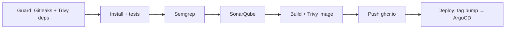

# Loop

Pipeline stages shared by all Everesto applications. An app's `ci.yml` looks like:

```yaml
jobs:
  guard:
    uses: Everesto-Inc/loop/.github/workflows/guard.yml@<sha> # v1.0.0
  ci:
    needs: guard
    runs-on: ubuntu-24.04-arm
    steps:
      - uses: actions/checkout@<sha>
      - name: Tests + coverage
        uses: Everesto-Inc/loop/stages/install@<sha>
        with: { stack: python }
      - name: Quality gate (SonarQube)
        uses: Everesto-Inc/loop/stages/sonarqube@<sha>
        with: { token: '${{ secrets.SONAR_TOKEN }}' }
      - run: ./scripts/my-own-step.sh          # level 2: own step
      - name: Build + scan image (Trivy)
        id: image
        uses: Everesto-Inc/loop/stages/build-image@<sha>
        with: { image: ghcr.io/everesto-inc/<repo> }
```


